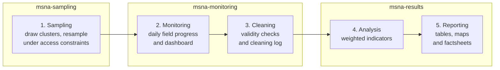

# MSNA pipeline

Public versions of my data work on the 2026 northern Nigeria Multi-Sector Needs Assessment (MSNA),
from drawing the sample to reporting the results. This repo is the hub: it shows how the stages
fit together and links to the stage repos, which hold the code.

**What an MSNA is.** An MSNA is a large household survey that humanitarian organisations run to
measure needs across sectors such as food, health, water, shelter and protection. Its findings feed
the yearly humanitarian planning cycle, which decides where aid goes and who it reaches.

**The real-world project.** The 2026 northern Nigeria MSNA covers 32,000 households across 11 states
and 176 local government areas (LGAs). Data collection runs with 20+ partner organisations, at up to
1,000 submissions a day. At that scale, the sample has to be redrawn when areas become unreachable,
and monitoring and cleaning have to keep pace with collection.

## How it works

The pipeline has five stages, split across three repos. Each stage hands its outputs to the next.

## Using the repos

This repo has no code. Each stage repo stands alone: clone it and follow its README.

The stages hand off data through `data/synthetic/`. Each stage commits its synthetic outputs there,
and the next stage copies them into `data/synthetic/from_<stage>/`. All stages use the same random
seed, so the whole chain can be rerun end to end and give the same results.

## How the public versions are built

The real survey data, sampling frames and partner details stay private. The public repos use only
synthetic and open data.

- **Open data:** administrative boundaries from HDX (COD-AB, Nigeria) and population data from
  WorldPop. Scripts download both, and each repo credits the source and licence.
- **Synthetic data:** made by seeded scripts that follow a reduced MSNA-style questionnaire of about
  30–40 questions. It uses standard indicators such as the Food Consumption Score (FCS), the reduced
  Coping Strategies Index (rCSI) and the Household Hunger Scale (HHS). Partners are "Partner A" to
  "Partner T", enumerators have fake IDs, and access constraints come from a synthetic layer. The
  data includes planted errors for the cleaning stage to catch.
- **Labelling:** every dashboard page, map and factsheet carries the label
  "Synthetic data – not real findings".
- **Checks before every commit:**
  - a scan against a private deny-list of names, contacts, internal paths and site names
  - a secret scan with [gitleaks](https://github.com/gitleaks/gitleaks)
  - a hash check that no file matches a real data file
  - a 2 MB file size limit

## Stage repos

| Stages | Repo | What it covers | Status |
| :- | :- | :- | :- |
| 1 | [`msna-sampling`](https://github.com/JackPhilpott/msna-sampling) | Sampling and resampling under access constraints, in R and Python | Live |
| 2–3 | [`msna-monitoring`](https://github.com/JackPhilpott/msna-monitoring) | Field monitoring, cleaning and validity checks, with a [live Shiny dashboard](https://jackphilpott.shinyapps.io/msna-monitoring/) | Live |
| 4–5 | `msna-results` | Analysis and reporting | Planned, mid-Nov 2026 |

Links are added as each repo goes public.

---

Built with AI-assisted development, reviewed and tested by me.
